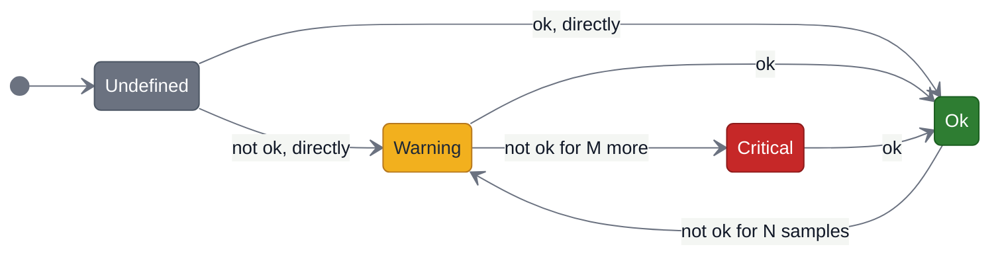

# ITRS Layer 0 Foundation

## Overview

The ITRS Layer 0 Foundation include file provides baseline Gateway configuration that the other ITRS Geneos Best Practice includes build on. It covers Gateway self-monitoring, configuration validation, rules for the Gateway's own data, common history periods, persistence and Self-Announcing Netprobe (SAN) settings. It does not define any Managed Entities, Types or Environments.

The include is embedded in the `geneos` program and is used by the `health-gateway` profile. It can be added to any Gateway and should sit at the base of the include hierarchy, with the lowest precedence, so that every other include and the main setup file can override it.

Files included, relative to your Geneos installation directory, for the example site name `acme`:

| File | Purpose |
| ---- | ------- |
| `gateway/includes/itrs.layer0.foundation.xml` | ITRS foundation definitions - read-only, replaced on update |
| `gateway/acme/acme-config.layer0.foundation.xml` | Your site foundation settings - empty by default, never overwritten |
| `gateway/acme/acme-config.layer0.authentication.xml` | Example authentication settings - see [Layer 0 Authentication](config.layer0.authentication.md) |

The `itrs` file is extracted into a version directory and linked from the `includes` directory, so Gateways always reference the same path:

```text
gateway/
├── includes/
│   ├── itrs.layer0.foundation.xml -> itrs-vx.y.z/itrs.layer0.foundation.xml
│   └── itrs-vx.y.z/itrs.layer0.foundation.xml
└── acme/
    ├── acme-config.layer0.authentication.xml
    └── acme-config.layer0.foundation.xml
```

>[!NOTE]
>Do not edit the `itrs` file. Put changes in the site file, or in the main setup file of a single Gateway, as these have a higher include priority and override the ITRS defaults. If no site name is set, the directory and prefix are `local`. See [Gateway Setup Files](https://docs.itrsgroup.com/docs/geneos/7.12.0/processing/configuration/gateway_setup_files/index.html).

## Installation

New installations created with `geneos` install the files automatically. For existing installations, install or refresh the embedded includes and update the links with:

```bash
geneos includes extract --update
```

Changed files in existing version directories are backed up. Existing site configuration files are never overwritten. To switch to another installed version use `geneos includes update --version itrs-vx.y.z`. See [`geneos includes`](../../../tools/geneos/docs/geneos_includes.md).

The `health-gateway` profile adds the functional include to the Gateway at priority `10000`, inside the include groups `ITRS Geneos Best Practice` and `Layer 0 - Foundation`. It does not add the `config.layer0.foundation.xml` or `config.layer0.authentication.xml` site files; add those yourself if you use them. The `demo` profile does not use Layer 0.

## Usage

1. Add the include files to your Gateway, either with `geneos set gateway NAME -i PRIORITY:PATH` (see [gateway](../../../tools/geneos/internal/component/gateway/gateway.md)) or by pasting this XML under `Includes` in the Gateway Setup Editor (GSE):

   ```xml
   <includeGroup name="ITRS Layer 0 - Foundation">
       <include>
           <priority>10000</priority>
           <required>true</required>
           <location>../../includes/itrs.layer0.foundation.xml</location>
       </include>
       <include>
           <priority>5000</priority>
           <required>true</required>
           <location>../../acme/acme-config.layer0.foundation.xml</location>
       </include>
   </includeGroup>
   ```

   Include priorities must be unique. A numerically lower priority takes precedence, so give the site file a lower number than the functional include. Because Layer 0 is the base of the hierarchy, use priorities numerically higher than those of the other layers.

2. To use Attribute Validation, set the `requiredAttributes` variable as described in [Attribute Validation](#attribute-validation).

No Types need to be attached. The Gateway self-monitoring samplers are added through the Operating Environment, and the rules apply wherever their targets match.

### Local foundation settings

`config.layer0.foundation.xml` is an empty Gateway setup file. It is installed as `<site>-config.layer0.foundation.xml` and is never overwritten by later installations. Use it for site-wide foundation settings shared by your Gateways, for example:

- the `requiredAttributes` list for Attribute Validation

- changed persistence timings, or different `selfAnnouncingProbes` settings

- replacement versions of the Layer 0 samplers or rules

Samplers and rules can be overridden by redefining them with the same name in the same sampler group or rule group. Redefined items replace the ITRS version completely, so copy the full item before changing it. Settings that apply to a single Gateway belong in that Gateway's main setup file.

## Contents

### Samplers

All samplers are in the `Layer 0 - Foundation` sampler group, in the sub-groups shown. None sets a sample interval, so the plugin default applies.

| Sampler | Sub-group | Plugin | Variable group | Notes |
| ------- | --------- | ------ | -------------- | ----- |
| Entities | Gateway Info | `Gateway-managedEntitiesData` | Gateway Info | `SummaryAndDetails` mode; adds a `priority` column to the `Entities Details` view |
| Gateway DateTime | Gateway Info | `Gateway-sql` | Gateway Info | Current date and time in UTC and Gateway local time |
| Licence | Gateway Info | `Gateway-licenceUsage` | Licence | |
| Severity Count | Gateway Info | `Gateway-severityCount` | Gateway Info | View paths `ENVIRONMENT`, `CATEGORY`, `APPLICATION`, `COMPONENT` |
| Severity Data | Gateway Info | `Gateway-severityData` | Gateway Info | Includes user-assigned and snoozed items, excludes self-generated items; attribute columns `ENVIRONMENT`, `CATEGORY`, `APPLICATION`, `COMPONENT` |
| Attribute Validation | Gateway Validation Tools | `Gateway-sql` | Validation | Checks every Managed Entity for required attributes |

The samplers are attached to the Gateway's self-monitoring Managed Entity through `selfMonitoring` overrides in the Operating Environment:

| Self-monitoring sampler | Replaced by |
| ----------------------- | ----------- |
| Entities | Entities |
| Severity Count | Severity Count |
| Custom | Licence |
| Custom | Severity Data |
| Custom | Gateway DateTime |
| Custom | Attribute Validation |

#### Entities

This version of the Entities sampler runs in `SummaryAndDetails` mode so that the `Entities Details` view is available. The detail view gives the diagnostics needed to check configured endpoint monitoring, and Attribute Validation depends on it. The sampler also adds a `priority` column to the detail view and publishes it with a string schema.

#### Gateway DateTime

The Gateway DateTime sampler uses the Gateway's integrated SQLite engine to show the current time in common formats, with one row per format and columns `name`, `utc` and `localtime`:

| Row | Format |
| --- | ------ |
| `date` | `YYYY-MM-DD` |
| `datetime` | `YYYY-MM-DD HH:MM:SS` |
| `dayofyear` | Day of the year, `001`-`366` |
| `epoch` | Seconds since the Unix epoch (same in both columns) |
| `excelSerial` | Spreadsheet serial date (days since 30 December 1899) |
| `iso8601` | ISO 8601, `Z` or a `+HH:MM` offset |
| `rfc3339` | RFC 3339 with fractional seconds |
| `time` | `HH:MM:SS` |
| `time-12` | 12-hour time with `AM` or `PM` |

Because of the SQLite dependency there is no support for IANA named timezones or for other regions with summer and winter time changes. The `localtime` column follows summer and winter changes according to the Gateway host's system settings.

#### Attribute Validation

The Attribute Validation sampler checks that each Managed Entity on the Gateway has a minimum set of attributes. It reads the `attributes` column of the `Entities Details` view and shows one row per Managed Entity, with columns `name`, `status` (`OK` or `Missing`) and `missing` (the missing attribute names, comma separated, in the order listed).

The required attributes come from the `requiredAttributes` variable, an external config file variable defined in the global Operating Environment. It is empty by default, so every Managed Entity shows `OK`. To set it, override the variable in your site file or main setup file and list one attribute name per line:

```text
ENVIRONMENT
APPLICATION
```

Attribute names are case sensitive. Blank lines, surrounding spaces and duplicates are ignored; no other checks are made.

### History Periods

| History Period | Type | Length |
| -------------- | ---- | ------ |
| `1 minute` | Rolling | 1 minute |
| `5 minutes` | Rolling | 5 minutes |
| `1 hour` | Rolling | 1 hour |
| `1 day` | Rolling | 1 day |
| `today` | Fixed | Current day |

### Rules

Most rules are in the `Layer 0 - Foundation` rule group, which has a default, `GLOBAL Administration Default`, setting priority group `11000` for its rules. All rules have priority `1`. The rules target the Gateway plugin views by plugin name, so they apply to any Gateway sampler of that kind, including the built-in self-monitoring samplers.

Many rules escalate in two steps. For the rules marked in the table, the condition must hold for the stated number of samples before the severity becomes `warning`, and if it is still true and the item is still in `warning` after a further delay, the severity becomes `critical`. For the other rules the first matching sample sets `warning` directly and only the escalation to `critical` is delayed. Where a rule can be in the `undefined` state before the condition is met, other than rules that use `undefined` as a normal result, the first matching sample goes directly to `warning`, for example after a Gateway restart. When the condition clears, the severity returns to `ok` or `undefined`, as shown. Delays are counted in samples, so they scale with each sampler's interval. At the default 20 second sample interval, 15 samples is five minutes and 30 samples is ten minutes. `samplingStatus` waits 15 samples, but its sampler intervals vary, so the time is longer for slower samplers.



>[!NOTE]
>Rules that use `undefined` as a normal result skip the "directly" step and wait the full N samples.

| Rule group | Rule | Target | Warning | Critical | Otherwise | Why |
| ---------- | ---- | ------ | ------- | -------- | --------- | --- |
| Layer 0 - Foundation | releaseAge | Gateway Data `releaseAge`; Client Connections `releaseAge` | > 182 | > 365 | `ok`; `undefined` if empty | Gateway and client software that is many months old is likely unpatched or near end of support. |
| Gateway | duration | Snoozed Items and User Assignments `duration` | > 10080 | > 20160 | `ok` | Snoozes and user assignments left in place for weeks tend to hide problems or become stale. |
| Analytics Connection | connectionStatus | ITRS Analytics Connection `Summary` view, `connectionStatus` | not `Ready`, for 15 samples | escalates after a further 30 samples | `ok`; `undefined` if `Statistics only` | If the Gateway is not connected to ITRS Analytics its data is not being forwarded. |
| Analytics Connection | messagesDroppedPerSample | ITRS Analytics Connection `Summary` view, `messagesDroppedPerSample` | > 0 and not falling, for 15 samples | escalates after a further 30 samples | `ok` | Dropped messages mean data is being lost on the way to ITRS Analytics. |
| Client Connections | duration | Client Connections `duration`; `Connections` view of samplers named `Global *` | > 10080 (one week in minutes) | - | `ok`; `undefined` for `GeneosWebServer` and `Gateway` components | Very long-lived client sessions are often forgotten connections. Gateways and web servers are expected to stay connected. |
| Database | cacheFiles | Database Logging `Cache` view, `cacheFiles` | > 0 and not falling, for 15 samples | escalates after a further 30 samples | `ok` | Cache files build up on disk when the logging database is unavailable or too slow. |
| Gateway Data | hotStandbyRole | Gateway Data `hotStandbyRole` | `Secondary` | escalates after 30 samples | `ok`; `undefined` if empty or `Stand Alone` | A Gateway running as the secondary means a failover has happened and the primary needs attention. |
| Gateway Data | secondaryGatewayConnectionStatus | Gateway Data `secondaryGatewayConnectionStatus` | not `Connected`, for 15 samples | escalates after a further 30 samples | `ok`; `undefined` if empty | A disconnected hot standby pair gives no failover protection. |
| Gateway Data | databaseConnectionStatus | Gateway Data `databaseConnectionStatus` | not `Connected`, for 15 samples | escalates after a further 30 samples | `ok`; `undefined` if empty | A Gateway without its database connection cannot log or retrieve historical data. |
| Import Export | connectionStatus | Imported Data `connectionStatus` | not `Up`, for 15 samples | escalates after a further 30 samples | `ok` | A broken import/export link between Gateways means data is missing on one side. |
| Import Export | conflictingProbes | Imported Data `conflictingProbes` | not empty, for 15 samples | escalates after a further 30 samples | `undefined` | The same probe reaching a Gateway by more than one route gives duplicate or inconsistent data. |
| Licence | connected | Licence `connected` | not `YES`, for 15 samples | escalates after a further 30 samples | `ok`; `undefined` if empty | Losing the licence connection starts the grace period, after which monitoring may stop. |
| Licence | licenceDaysRemaining | Licence `licenseDaysRemaining` | < 30 | < 8 | `ok` | Gives time to renew the licence before it expires. |
| Licence | gracePeriodRemaining | Licence `gracePeriodRemaining`, in days | < 3 | < 1 | `ok`; `undefined` if `gracePeriodMode` is `NO` | Shows how long monitoring will continue while the Gateway has no valid licence. |
| Netprobes | probesDown | Netprobes headline `probesDown` | > 0 | escalates after 30 samples | `ok`; `undefined` if empty | Probes that are down mean the hosts they monitor are not being checked. |
| Netprobes | connectionState | Netprobes `connectionState` | not `Up` | escalates after 30 samples | `ok`; `undefined` if empty | The same check for each individual probe, to show which one is affected. |
| Netprobes | managedEntityCount | `managedEntityCount` column of any sampler | = 0 | escalates after 30 samples | `undefined` | A probe or sampler with no Managed Entities is monitoring nothing, which is usually a configuration error. |
| Performance | maxDataAge | Netprobes headline `maxDataAge` | > 20000 | > 60000 after 2 samples, or > 20000 and not falling for 60 seconds | `ok` | Old data means slow probes or network delays, so views and alerts lag behind real conditions. |
| Sampling Status | samplingStatus | `samplingStatus` headline of every sampler | any other value | escalates after 15 samples | `undefined` for `OK`, `NOTE:*` or `INFO:*` | A sampler reporting a problem is not collecting reliable data. |

>[!NOTE]
>The "Why" column is inferred from the rule names, their behaviour and common monitoring practice, not from original design notes.

The rule groups other than `Layer 0 - Foundation` and `Sampling Status` are nested inside `Layer 0 - Foundation`, under the `Gateway` rule group. `Sampling Status` is a separate top-level rule group, so the `GLOBAL Administration Default` does not apply to it.

Notes on specific rules:

- `releaseAge` thresholds are about six months and one year.

- The Licence Usage view reports `licenseDaysRemaining`, `releaseAge` and `gracePeriodRemaining` with a unit, for example `63 days`, in its `Value` column. The `gracePeriodMode` and `gracePeriodRemaining` rows are present in the Licence Usage view, although the Geneos plug-in reference lists only the `licenseGracePeriodMode` and `licenseGracePeriodRemaining` cells of the Gateway Data plugin.

- The `duration` thresholds of 10080 and 20160 are one and two weeks when measured in minutes.

- "Not falling" means the value is above zero and its rate of change is zero or more. A count that is falling, such as a cache being emptied, does not escalate.

- `probesDown` deliberately has no rate test. Every probe matters, and a falling number of probes down should not hide a critical alert for endpoints that are still not monitored.

- `maxDataAge` uses a delay in seconds, not samples, from `warning` to `critical`, because samples may themselves be delayed and the escalation should still happen after a fixed time. The XML notes that this behaviour is not confirmed.

### Persistence

The include defines an empty `persistence` section, which enables persistence with the default write and rewrite periods. If the default timings are not suitable, override them in a higher priority include file or the main setup file.

### Self-Announcing Probes

| Setting | Value |
| ------- | ----- |
| `enabled` | `true` |
| `disconnectedProbeTimeout` | `3600` (seconds) |

Self-Announcing Netprobes are accepted by any Gateway that uses this include. To refuse them, or to change the timeout, override `selfAnnouncingProbes` in your site file or main setup file.

### Operating Environment

In addition to the self-monitoring overrides listed under [Samplers](#samplers), the Operating Environment sets:

| Setting | Value |
| ------- | ----- |
| `requiredAttributes` variable | Empty external config file; see [Attribute Validation](#attribute-validation) |
| `writeStatsToFile` | File `stats.xml`, periodic write enabled, interval `50` |

The `health-gateway` profile also starts the Gateway with the `-stats` option.

## Upgrades

The functional include is replaced on each update. Do not edit it; keep all local changes in `<site>-config.layer0.foundation.xml` or the main setup file, so they survive updates. After an update, compare any samplers or rules you have redefined with the new ITRS versions and merge relevant changes.

The rule group `Analytics Conection` has been renamed `Analytics Connection`, and `gracePeriodRemaining` now goes critical when less than one day of grace remains instead of after a delay. If you have redefined rules in the old group, move them to the new group name.

## Review Notes

- The two-step rules previously contained a delay with no update before the escalation logic, which had no effect, so `warning` was set on the first matching sample. The delay now applies to the `warning` step as documented in the table.
