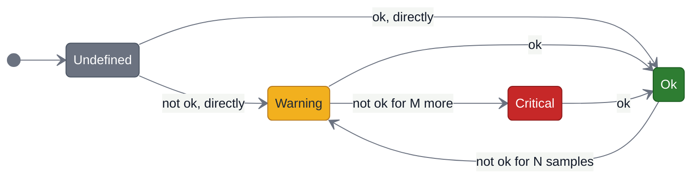

# ITRS Layer 1 Server Health

## Overview

The ITRS Layer 1 Server Health include file provides pre-configured, best practice monitoring of server CPU, disk, memory, hardware and network interfaces through a single Gateway Type, `Layer 1 - Server Health`. It is embedded in the `geneos` program and can be added to any Gateway. The `demo` and `health-gateway` profiles add it to the Gateway they create, and the `health-agent` profile attaches the Type to its Self-Announcing Netprobe (SAN).

Files included, relative to your Geneos installation directory, for the example site name `acme`:

| File | Purpose |
| ---- | ------- |
| `gateway/includes/itrs.layer1.server-health.xml` | ITRS monitoring definitions - read-only, replaced on update |
| `gateway/acme/acme-config.layer1.server-health.xml` | Your site configuration - a Managed Entity Group and an empty override Environment, never overwritten |

The `itrs` file is extracted into a version directory and linked from the `includes` directory, so Gateways always reference the same path:

```text
gateway/
├── includes/
│   ├── itrs.layer1.server-health.xml -> itrs-vx.y.z/itrs.layer1.server-health.xml
│   └── itrs-vx.y.z/itrs.layer1.server-health.xml
└── acme/acme-config.layer1.server-health.xml
```

>[!NOTE]
>Do not edit the `itrs` file. Put changes in the site file, or in the main setup file of a single Gateway, as these have a higher include priority and override the ITRS defaults. If no site name is set, the directory and prefix are `local`. See [Gateway Setup Files](https://docs.itrsgroup.com/docs/geneos/7.12.0/processing/configuration/gateway_setup_files/index.html).

## Installation

New installations created with `geneos` set this up automatically. For existing installations, follow the upgrade steps below before updating the links:

```bash
geneos includes extract --update
```

Changed files in existing version directories are backed up. Existing site configuration files are never overwritten. To switch to another installed version use `geneos includes update --version itrs-vx.y.z`. See [`geneos includes`](../../../tools/geneos/docs/geneos_includes.md).

### Upgrading from an earlier include

The former `itrs.level1.infrastructure.xml` and `itrs.level1.server-health.xml` includes and their matching site configurations have been renamed. Existing Gateway setups, site overrides and user profiles are not updated automatically.

1. Back up your Gateway setups and site configuration. Run `geneos includes install` without `--update` to install the new files while keeping existing links.

2. Copy or merge overrides from your old site configuration into the new `layer1.server-health.xml` site file, preserving any settings already there. Update references to the old `Level 1 - Infrastructure` or `Level 1 - Server Health` types, groups, environments and XPath targets in those overrides.

3. Update Gateway include paths and any type, group and environment references in Gateway setups, customised profiles and SAN configurations to the new Server Health names.

4. Once no Gateway setup references the old include link, run `geneos includes update`. The update refuses to remove an old link that is still in use.

Two rules have also been renamed: `percentagUsed` is now `percentageUsed`, and `networkStatus - Windows` is now `tcpRetransmissionRate - Windows`. If your site file redefines either rule, rename the copy to match; otherwise the old copy becomes a separate rule alongside the new one.

Rule XPaths must use the original dataview name, not a display name. On Windows the Hardware and Network dataviews are named `NT-HARDWARE` and `NT-NETWORK`; the `Hardware` and `Network` names are for display only.

## Usage

>[!NOTE]
>If you have used a profile to install Geneos then the include is most likely already configured and you can go to step 2. The `demo` profile uses include priorities 1000 (ITRS file) and 500 (site file); the `health-gateway` profile uses 11000 and 500.

1. Add both files to your Gateway, either with `geneos set gateway NAME -i PRIORITY:PATH` (see [gateway](../../../tools/geneos/internal/component/gateway/gateway.md)) or by pasting this XML under `Includes` in the Gateway Setup Editor (GSE):

   ```xml
   <includeGroup name="ITRS Layer 1 - Server Health">
       <include>
           <priority>1000</priority>
           <required>true</required>
           <location>../../includes/itrs.layer1.server-health.xml</location>
       </include>
       <include>
           <priority>500</priority>
           <required>true</required>
           <location>../../acme/acme-config.layer1.server-health.xml</location>
       </include>
   </includeGroup>
   ```

2. Attach the Type to your Managed Entities, either by placing them in the Managed Entity Group `Layer 1 - Server Health` from the site file, or by adding the Type directly:

   | Type | Environment |
   | ---- | ----------- |
   | `Layer 1 - Server Health` | `Layer 1 - Server Health Local` |

   The Managed Entity Group also sets the attributes `CATEGORY=Infrastructure` and `COMPONENT=System`.

   For a SAN, add the Type by name with `geneos set san NAME -t 'Layer 1 - Server Health'` (see [san](../../../tools/geneos/internal/component/san/san.md)). The `health-agent` profile does this for the SAN's own Managed Entity, which gets the profile's attributes (`CATEGORY=Health` and others) rather than those of the Managed Entity Group.

The Type always uses its `Layer 1 - Server Health Defaults` Environment from the ITRS file. To change the defaults for Managed Entities in the group, or with the Type added as above, define the variables to override in the `Layer 1 - Server Health Local` Environment (in the `Layer 1 - Server Health` environment group) in your site file. A SAN names the Type without an Environment, so the `Local` Environment does not apply to it.

Samplers and rules can be overridden by redefining them with the same name and group in a higher priority file. Redefined items replace the ITRS version completely, so copy the full item before changing it. The same applies to the `Layer 1 - Server Health Defaults` Environment, which changes the defaults for every user of the Type, including SANs. See [User Variables and Environments](https://docs.itrsgroup.com/docs/geneos/6.0.0/processing/gateway-administration/gateway_user_variables_and_environments/).

## Contents

### Samplers

The samplers are defined in the `Layer 1 - Server Health` sampler group and appear under the `System` sampler group in the Active Console, set by the Type variable `SAMPLER_GROUP`.

| Sampler | Plugin | Interval | Notes |
| ------- | ------ | -------- | ----- |
| CPU | [cpu](https://docs.itrsgroup.com/docs/geneos/7.4.0/collection/cpu/index.html) | `FAST_SAMPLE` | |
| Disk | [disk](https://docs.itrsgroup.com/docs/geneos/7.4.0/collection/disk/index.html) | `SLOW_SAMPLE` | Auto-detects partitions; see exclusions below; NFS partitions not checked; expected rows from `EXPECTED_PARTITIONS` |
| Hardware | [hardware](https://docs.itrsgroup.com/docs/geneos/7.4.0/collection/hardware/) | `NORMAL_SAMPLE` | Windows `NT-HARDWARE` dataview displayed as `Hardware` |
| Network | [network](https://docs.itrsgroup.com/docs/geneos/7.4.0/collection/network/index.html) | `FAST_SAMPLE` | Shows virtual interfaces; excludes loopback and unconfigured NICs; rates in Mbits and absolute values shown; Windows `NT-NETWORK` dataview displayed as `Network` |

The Disk sampler excludes these partitions, which are pseudo, container, snap or optical media file systems:

| Exclude by | Values |
| ---------- | ------ |
| Path | `/dev/*`, `/run/*`, `/proc/*`, `/sys/*`, `/dev/pts`, `/cdrom/*` |
| File system | `overlay`, `tmpfs`, `fuse.snapfuse`, `9p`, `squashfs`, `CDFS`, `UDF` |

### Variables

These are defined in the `Layer 1 - Server Health Defaults` Environment, in the `Layer 1 - Server Health` environment group.

| Variable | Default | Purpose |
| -------- | ------- | ------- |
| `FAST_SAMPLE` | `5` | CPU and Network sample interval (seconds) |
| `NORMAL_SAMPLE` | `20` | Hardware sample interval (seconds) |
| `SLOW_SAMPLE` | `300` | Disk sample interval (seconds) |
| `EXPECTED_PARTITIONS` | empty list | Partitions expected in the Disk view |

The include also sets the Gateway operating environment variable `hyperThreadingOK` to `false`, used by the `hyperThreading` rule.

### Rules

Rules are in the `Layer 1 - Server Health` rule group, with one sub-group per sampler. They only target samplers from the `Layer 1 - Server Health` Type. "Not falling" means the rate of change of the value is zero or more. Delays counted in samples depend on the sampler interval, so slow samplers wait longer. At the default intervals 12 samples is one minute for CPU, four minutes for Hardware and one hour for Disk. The Hardware memory and swap rules use 15 samples (five minutes) for warning and a further 45 (15 minutes) for critical, and the CPU rules keep 12 samples at the `FAST_SAMPLE` interval.



>[!NOTE]
>Delayed rules follow this pattern, where N and M are the sample counts in the table. Rules that use `undefined` as a normal result, such as `stuckCPUCore` and `zombieProcesses`, skip the "directly" step and wait the full N.

| Group | Rule | Target | Warning | Critical | Why |
| ----- | ---- | ------ | ------- | -------- | --- |
| CPU | `averageCPUUtilisation` | `Average_cpu` row (Unix) or `_Total` row (Windows) utilisation | > 80% and not falling, for 12 samples | Warning for a further 12 samples, or > 95% for 12 samples | Sustained high CPU slows applications and delays work, while short spikes are ignored. |
| CPU | `stuckCPUCore` | Each CPU core row | > 99% for 12 samples | Warning for a further 12 samples and not falling | One core pinned at 100% suggests a runaway or stuck thread even when the average looks healthy. |
| CPU | `hyperThreading` | Hyper-threading status in the CPU or Hardware view | `ENABLED` while `hyperThreadingOK` is `false` | - | Hyper-threading is flagged where site policy expects it to be off, for performance or licensing reasons. |
| Disk | `percentageUsed` | `percentageUsed` for each partition | >= 90% and not falling | Warning for 12 samples, or >= 98% | A full disk causes outages, so warning comes early enough to act and critical comes near full. |
| Hardware | `memoryUsedPercent` | `memoryUsedPercent` row | > 90% and not falling, for 15 samples | Warning for a further 45 samples, or > 98% | Memory exhaustion leads to swapping and processes being killed. |
| Hardware | `swapUsed` | `swapUsed` row | > 10, or > 5 and not falling, for 15 samples | Warning for a further 45 samples | Use of swap signals memory pressure and degrades performance. |
| Hardware | `zombieProcesses` | `zombieProcesses` row (Unix) | not `0` or `NA`, for 300 seconds | Warning for a further 300 seconds and not falling | Zombies pile up when a parent does not collect its children, which points to an application fault and can exhaust process IDs. |
| Network | `networkStatus - Unix` | `status` of each interface | Any value other than `OK` | `DOWN` | An interface that is down means lost connectivity. |
| Network | `tcpRetransmissionRate - Windows` | `tcpRetransmissionRate` headline | > 20 | > 999999 (placeholder) | Many retransmissions point to packet loss or congestion. The critical limit is a placeholder. |

>[!NOTE]
>The "Why" column is inferred from the rule names, their behaviour and common monitoring practice, not from original design notes.

Where a warning needs the condition to hold for a number of samples, a rule whose severity is still `undefined`, for example after a Gateway restart, goes to `warning` on the first matching sample; `stuckCPUCore` does not, because it uses `undefined` as its normal state. Values below the warning thresholds are set to `OK`, except that `stuckCPUCore` and `hyperThreading` clear the severity, and `zombieProcesses` clears it for `0` or `NA`. The Disk rule ignores rows with a `totalSpace` of `0`, which are typically pseudo-devices, and `networkStatus - Unix` ignores empty values. The `tcpRetransmissionRate - Windows` critical threshold is a placeholder; redefine the rule with a realistic value to use it.

### Exported data

The include defines an exported data set, `Layer 1 - Server Health`, containing all samplers from the `Layer 1 - Server Health` Type.
