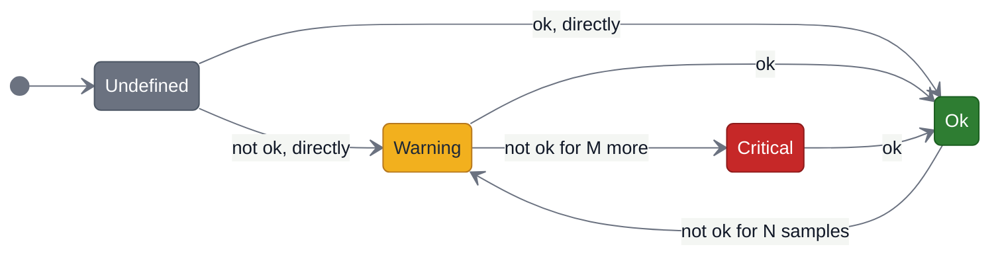

# ITRS Layer 2 Programs and Logs

## Overview

The ITRS Layer 2 Programs and Logs include file provides a shared baseline for application monitoring through a single Gateway Type, `Layer 2 - Application Baseline`. The Type adds three samplers to a Managed Entity: `Logs` (File Keyword Monitor), `Processes` and `Services` (Windows Services).

The `Logs` and `Processes` samplers are deliberately empty. Layer 3 application include files, such as [ITRS Layer 3 Geneos](itrs.layer3.geneos.md), and your own sampler includes add the log files and processes to monitor. This keeps one `Logs` and one `Processes` dataview per Managed Entity, regardless of how many applications contribute to them.

The include is embedded in the `geneos` program, used by the `demo`, `health-gateway` and `health-agent` profiles, and can be added to any Gateway.

Files included, relative to your Geneos installation directory, for the example site name `acme`:

| File | Purpose |
| ---- | ------- |
| `gateway/includes/itrs.layer2.programs-and-logs.xml` | ITRS monitoring definitions - read-only, replaced on update |
| `gateway/acme/acme-config.layer2.programs-and-logs.xml` | Your site configuration - created from the `config.layer2.programs-and-logs.xml` template, never overwritten |

The `itrs` file is extracted into a version directory and linked from the `includes` directory, so Gateways always reference the same path:

```text
gateway/
├── includes/
│   ├── itrs.layer2.programs-and-logs.xml -> itrs-vx.y.z/itrs.layer2.programs-and-logs.xml
│   └── itrs-vx.y.z/itrs.layer2.programs-and-logs.xml
└── acme/acme-config.layer2.programs-and-logs.xml
```

>[!NOTE]
>Do not edit the `itrs` file. Put changes in the site file, or in the main setup file of a single Gateway, as these have a higher include priority and override the ITRS defaults. If no site name is set, the directory and prefix are `local`. See [Gateway Setup Files](https://docs.itrsgroup.com/docs/geneos/7.12.0/processing/configuration/gateway_setup_files/index.html).

## Installation

New installations created with `geneos` set this up automatically. For existing installations, follow the upgrade steps below before updating the links:

```bash
geneos includes extract --update
```

Changed files in existing version directories are backed up. Existing site configuration files are never overwritten. To switch to another installed version use `geneos includes update --version itrs-vx.y.z`. See [`geneos includes`](../../../tools/geneos/docs/geneos_includes.md).

### Upgrading from an earlier include

The former `itrs.level2.application-core.xml` include and its matching site configuration have been renamed. The `Level 2 - Application Core` Type, groups and environments are now named `Layer 2 - Application Baseline`. Existing Gateway setups, site overrides and user profiles are not updated automatically.

1. Back up your Gateway setups and site configuration. Run `geneos includes install` without `--update` to install the new files while keeping existing links.

2. Copy or merge overrides from your old site configuration into the new `layer2.programs-and-logs.xml` site file, preserving any settings already there. Update references to the old `Level 2 - Application Core` Type, groups, environments and XPath targets in those overrides.

3. The `Layer 2 - Application Baseline Overrides` environment and the Managed Entity Group have been removed from the `itrs` file. Move any settings from the `Overrides` environment into the `Layer 2 - Application Baseline Local` environment in the site file, which also now holds the Managed Entity Group.

4. Update Gateway include paths and any Type, group and environment references in Gateway setups, customised profiles and SAN configurations to the new names.

5. Once no Gateway setup references the old include link, run `geneos includes update`. The update refuses to remove an old link that is still in use.

## Usage

>[!NOTE]
>If you have used a profile to install Geneos then the include is most likely already configured and you can go to step 2.

1. Add both files to your Gateway, either with `geneos set gateway NAME -i ...` (see [gateway](../../../tools/geneos/internal/component/gateway/gateway.md)) or by pasting this XML under `Includes` in the Gateway Setup Editor (GSE):

   ```xml
   <includeGroup name="ITRS Layer 2 - Application Baseline">
       <include>
           <priority>1000</priority>
           <required>true</required>
           <location>../../includes/itrs.layer2.programs-and-logs.xml</location>
       </include>
       <include>
           <priority>500</priority>
           <required>true</required>
           <location>../../acme/acme-config.layer2.programs-and-logs.xml</location>
       </include>
   </includeGroup>
   ```

   Use priorities that do not clash with other includes on the Gateway, keeping the site file numerically lower than the `itrs` file so that it takes precedence.

2. Attach the Type to your Managed Entities, either by placing them in the `Layer 2 - Application Baseline` Managed Entity Group from the site file, or by adding the Type directly:

   | Type | Environment |
   | ---- | ----------- |
   | `Layer 2 - Application Baseline` | `Layer 2 - Application Baseline Local` |

   For a Self-Announcing Netprobe (SAN), use `-t 'Layer 2 - Application Baseline'`.

3. Add the log files and processes to monitor. Attach a Layer 3 Type whose sampler includes reference the `Logs` and `Processes` samplers, or create your own sampler includes in the site file. See [Extending the samplers](#extending-the-samplers).

To change the defaults, define the variables to override in the `Layer 2 - Application Baseline Local` environment (in the `Layer 2 - Application Baseline` environment group) in your site file. Samplers and rules can be overridden by redefining them with the same name and group. Redefined items replace the ITRS version completely, so copy the full item before changing it. See [User Variables and Environments](https://docs.itrsgroup.com/docs/geneos/6.0.0/processing/gateway-administration/gateway_user_variables_and_environments/).

### Site configuration template

The site file is created from `config.layer2.programs-and-logs.xml` and contains:

| Item | Name | Purpose |
| ---- | ---- | ------- |
| Managed Entity Group | `Layer 2 - Application Baseline` | Adds the Type with the `Local` environment, and the attributes `CATEGORY=Application` and `COMPONENT=Baseline` |
| Environment | `Layer 2 - Application Baseline Local` | Empty; add site values for `LOGS_ACTIVE`, `PROCESSES_ACTIVE` and `processInstances` here |

Managed Entities added through the group get the Type with the `Local` environment. If you add the Type to a Managed Entity directly, reference the `Local` environment yourself if you want its settings.

### Profiles and SANs

The `geneos` profiles use this include as follows:

| Profile | Use |
| ------- | --- |
| `demo` | Adds the `itrs` file at priority `1010` and the site file at priority `510` to the Demo Gateway |
| `health-gateway` | Adds the `itrs` file at priority `1050` and the site file at priority `550` to the Health Gateway |
| `health-agent` | Adds the `Layer 2 - Application Baseline` and `Layer 3 - Geneos Component` Types to every per-component Managed Entity through `managed-entities-common` |

For each Geneos component Managed Entity, the `health-agent` profile also sets the variables used by the Layer 3 sampler includes (`instanceName`, `instanceType`, `instanceExecPath`, `logFilePath`, `consoleLogFilePath`) and `processInstances`, which is used by the `processInstances` rule in this include. See [`geneos profile`](../../../tools/geneos/docs/geneos_profile.md).

## Contents

### Samplers

All samplers are in the `Layer 2 - Application Baseline` sampler group and use the plugin's default sample interval.

| Sampler | Plugin | Settings |
| ------- | ------ | -------- |
| Logs | `fkm` | No files; PCRE regular expressions; `MULTIPLE_GROUPED_TRIGGER` trigger mode, last trigger not shown in status; default file active time `LOGS_ACTIVE`; extended Windows event log output; persistent data saved to `fkm` |
| Processes | `processes` | No processes; PCRE regular expressions; sampler active time `PROCESSES_ACTIVE` |
| Services | `win-services` | Default settings; for Windows Netprobes |

The `Logs` dataview shows the `status`, `permissions`, `lastModificationTime`, `fileSize`, `updateRate`, `triggerDetails`, `fileOwner` and `absolutePath` columns. Persistent data lets the sampler resume from its last position in each file after a Netprobe restart.

The `Logs` and `Processes` samplers appear under the `Programs and Logs` sampler group in the Active Console, set by the `SAMPLER_GROUP` variable on the Type.

### Variables

| Variable | Default | Purpose |
| -------- | ------- | ------- |
| `SAMPLER_GROUP` | `Programs and Logs` | Display group for the `Logs` and `Processes` samplers; set on the Type |
| `LOGS_ACTIVE` | `Application - Always` | Default active time for files in the `Logs` sampler |
| `PROCESSES_ACTIVE` | `Application - Always` | Active time for the `Processes` sampler |
| `processInstances` | not defined | Expected instance count ranges for the `processInstances` rule |

`LOGS_ACTIVE` and `PROCESSES_ACTIVE` are defined in the `Layer 2 - Application Baseline Defaults` environment, which the Type references. The `Application - Always` active time (in the `Layer 2 - Application Baseline` active time group) covers every day of the week. Override either variable with your own active time to limit monitoring to application hours.

Set `processInstances` to one entry per process, in the form `(ROWNAME,MIN..MAX)` or `(ROWNAME,COUNT)`, where `ROWNAME` is the process row name in the `Processes` dataview. A single `COUNT` is an exact match and is the same as `COUNT..COUNT`. For example, `(myapp,1)(worker,2..4)` expects exactly one `myapp` process and between two and four `worker` processes. An entry for the row name is matched exactly. The special row name `*`, as in `(*,1..5)`, is used for every row that has no entry of its own, so `(myapp,1)(*,0..99999)` checks only `myapp`.

The variable can be either a string in this format, which the user must format correctly, or a name-value list. In a name-value list each name must be the process row name and each value must be either a single number or a range in the form `num..num`.

### Rules

The rules are in the `Layer 2 - Application Baseline` rule group, at priority `10000`.



>[!NOTE]
>`processInstances` follows this pattern, with N of 15 samples and M of 45. `logStatus` applies it to `NOT_FOUND` only, and has no "directly" step because `undefined` is one of its normal results.

| Rule | Target | OK | Warning | Critical | Undefined | Why |
| ---- | ------ | -- | ------- | -------- | --------- | --- |
| `processInstances` | `instanceCount` of each `Processes` sampler row in the Type, without `#` in its name | Count within range | Count outside range for 15 samples, or directly from `undefined` | A further 45 samples at warning | Empty count | An application process that is not running, or running too many times, shows the application is down or misbehaving. |
| `logStatus` | `status` of FKM samplers in the `Layer 2 - Application Baseline` Type | `OK` | `NOT_FOUND*` for 15 samples, or empty status on a row whose name contains `warning` | `NOT_FOUND*` for a further 45 samples, or empty status on a row whose name contains `fail` | Any other status | A missing monitored log file means that file is not being watched, and rows flagged as warning or fail signal problems in the logs. |

>[!NOTE]
>The "Why" column is inferred from the rule names, their behaviour and common monitoring practice, not from original design notes.

For `processInstances`, a process row with neither its own entry nor a `(*,...)` entry in the `processInstances` variable uses a range of `1` to `99999`, so it alerts only if no instance is running, because a process that is monitored is expected to run. The rule only targets Processes samplers from the `Layer 2 - Application Baseline` Type, which includes the processes added by the Layer 3 sampler includes.

The `Layer 2 - Application Baseline` exported data set publishes all samplers of this Type.

### Extending the samplers

Sampler includes add configuration to an existing sampler of the same name on the same Managed Entity. To monitor an application, create a sampler include that references `Logs` or `Processes` and add the files or processes, then add it to a Type that is attached alongside `Layer 2 - Application Baseline`.

[ITRS Layer 3 Geneos](itrs.layer3.geneos.md) uses this pattern for Geneos components:

| Sampler include | Extends | Adds |
| --------------- | ------- | ---- |
| `Layer 3 - Geneos Component Logs` | `Logs` | The component main log and console log |
| `Layer 3 - Geneos Collection Agent Logs` | `Logs` | Collection Agent log files |
| `Layer 3 - Geneos Component Process` | `Processes` | The component process |

These sampler includes do nothing unless `Layer 2 - Application Baseline` is also attached to the Managed Entity. See also [Layer 3 Geneos site configuration](config.layer3.geneos.md).

## Review Notes

- The `Services` sampler does not use `SAMPLER_GROUP`, so it is not shown in the `Programs and Logs` sampler group with the other two samplers.
