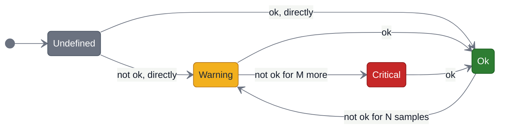

# ITRS Layer 3 Geneos Documentation

## Overview

`itrs.layer3.geneos.xml` defines reusable Types, samplers, sampler includes, a process descriptor, commands, rules and an exported data set for monitoring Geneos itself: the Geneos installation and instances on a host, individual Geneos components, Gateway load, and Gateway information. It contains no Managed Entity hierarchy; the matching `config.layer3.geneos.xml` provides an example configuration. It is embedded in the `geneos` program and used by the `health-gateway` and `health-agent` profiles.

Files included, relative to your Geneos installation directory, for the example site name `acme`:

| File | Purpose |
| ---- | ------- |
| `gateway/includes/itrs.layer3.geneos.xml` | ITRS monitoring definitions - read-only, replaced on update |
| `gateway/acme/acme-config.layer3.geneos.xml` | Your site configuration - example hierarchy and empty environments, never overwritten |

If no site name is set, the directory and prefix are `local`.

Treat the functional include as read-only so it can be upgraded from later releases without losing local changes. Keep Managed Entity setup and site-specific overrides in the site configuration file or in your Gateway's main setup file. See [Layer 3 Geneos Configuration Example](config.layer3.geneos.md).

## Dependencies

- The `Layer 3 - Geneos Instances`, `Layer 3 - Geneos Instances Diagnostics` and `Layer 3 - Geneos Gateway Info` Types run the `geneos` program on the Netprobe host and do not depend on other includes.

- The `Layer 3 - Geneos Component` and `Layer 3 - Geneos Netprobe Additions` Types contain only sampler includes. These extend the `Logs` and `Processes` samplers of the `Layer 2 - Application Baseline` Type, so include `itrs.layer2.programs-and-logs.xml` and attach `Layer 2 - Application Baseline` to the same Managed Entity.

- The Gateway load rules use the `1 minute`, `5 minutes`, `1 hour`, `1 day` and `today` history periods, which are defined in `itrs.layer0.foundation.xml`.

## Usage

>[!NOTE]
>If you have used the `health-gateway` and `health-agent` profiles then the include and Types are most likely already configured. See [Profile Usage](#profile-usage).

1. Add both files to your Gateway, either with `geneos set gateway NAME -i ...` or by pasting this XML under `Includes` in the Gateway Setup Editor (GSE). The priorities shown are those used by the `health-gateway` profile:

   ```xml
   <includeGroup name="ITRS Layer 3 - Geneos">
       <include>
           <priority>1020</priority>
           <required>true</required>
           <location>../../includes/itrs.layer3.geneos.xml</location>
       </include>
       <include>
           <priority>520</priority>
           <required>true</required>
           <location>../../acme/acme-config.layer3.geneos.xml</location>
       </include>
   </includeGroup>
   ```

   Give the site configuration a numerically lower priority than the functional include so that its settings take precedence. Include priorities must be unique.

2. Attach the Types to your Managed Entities, either through a Managed Entity Group modelled on `config.layer3.geneos.xml` or by adding the Types directly, and set the per-entity variables described in [Per-Entity Variables](#per-entity-variables).

### Upgrading from an earlier include

Several names have changed. Existing Gateway setups, site files and customised profiles are not updated automatically; update any references as follows:

| Earlier name | Current name |
| ------------ | ------------ |
| Type `Layer 3 - Geneos Diagnostics` | `Layer 3 - Geneos Instances Diagnostics` |
| Types `Layer 3 - Geneos Active Console`, `Floating Netprobe`, `Gateway`, `Licence Daemon`, `Netprobe`, `Netprobe-Router`, `Self Announcing Netprobe`, `SSO-Agent` and `Webserver` | `Layer 3 - Geneos Component`, plus `Layer 3 - Geneos Netprobe Additions` for Netprobes |
| Environment `Layer 3 - Geneos Overrides` | `Layer 3 - Geneos Local` (site file) |
| Environment `Layer 3 - Geneos Load Overrides` | `Layer 3 - Geneos Load Local` (site file) |
| Environment group `Layer 3 - Gateway Info` | `Layer 3 - Geneos Gateway Info` |
| Data Quality log file variable `_gatewayLogFile` | `logFilePath` |

`Layer 3 - Geneos Load Defaults` no longer defines `statsFilePath` (previously `stats.xml`). Set `statsFilePath` and `logFilePath` on every Gateway load Managed Entity that does not already have them; the `health-agent` profile sets both.

## Type Entrypoints

| Type | Use | Samplers / behavior |
| --- | --- | --- |
| Layer&nbsp;3&nbsp;-&nbsp;Geneos&nbsp;Instances | Monitor the Geneos installation on a host. | Runs the local `geneos` command to report AES files, certificates, installed releases, configured instances, running processes, a version summary, and shared and Gateway include files. |
| Layer&nbsp;3&nbsp;-&nbsp;Geneos&nbsp;Instances&nbsp;Diagnostics | Add process-level diagnostics. | Reports open files and open TCP ports of running instances. Use where the additional detail is useful. |
| Layer&nbsp;3&nbsp;-&nbsp;Geneos&nbsp;Component | Monitor one Geneos component instance of any type. | Adds the component log, console log and process to the Layer 2 `Logs` and `Processes` samplers, driven by per-entity variables. |
| Layer&nbsp;3&nbsp;-&nbsp;Geneos&nbsp;Netprobe&nbsp;Additions | Monitor the Collection Agent log of a Netprobe. | Adds the Collection Agent log files to the Layer 2 `Logs` sampler. Use together with `Layer 3 - Geneos Component`. |
| Layer&nbsp;3&nbsp;-&nbsp;Geneos&nbsp;Gateway&nbsp;Load | Inspect Gateway load from the Gateway statistics file. | Components, connections, rules grouped by several dimensions, database logging, Gateway SQL, rule threads, and data quality. `Rules by Sampler and Rule` and `Rules by Entity-Rule` are disabled in the Type. |
| Layer&nbsp;3&nbsp;-&nbsp;Geneos&nbsp;Gateway&nbsp;Load&nbsp;XPaths | Inspect Gateway XPath load. | Absolute and relative XPath statistics. |
| Layer&nbsp;3&nbsp;-&nbsp;Geneos&nbsp;Gateway&nbsp;Info | Copy Gateway information dataviews from a Gateway. | Uses `geneos snapshot` to republish the Gateway Info, Import Export, Licence and ITRS Analytics dataviews of the Gateway named by `instanceName`. |

The Instances and Instances Diagnostics Types set `SAMPLER_GROUP` to `Geneos Instances`; the Gateway load Types set it to `Gateway Load`. The Gateway Info samplers set their own sampler groups, `Gateway Info`, `Import Export`, `Licence` and `ITRS Analytics`. The component Types do not set `SAMPLER_GROUP`; their sampler includes inherit the settings of the Layer 2 samplers they extend.

## Samplers

### Geneos Instances

The instance and diagnostics samplers are Toolkit samplers. Each assembles its command line as `geneosExecPath`, a space, `geneosExecConfigPath`, the arguments below, and `geneosExecHosts`.

| Sampler | Type | `geneos` arguments | Interval |
| ------- | ---- | ------------------ | -------- |
| AES Files | Instances | `aes ls -t` | `SLOW_SAMPLE` |
| Certificates | Instances | `tls ls -tal` | On start, then daily at 01:00 |
| Gateway Includes | Instances | `includes ls --gateway -f toolkit` | `SLOW_SAMPLE` |
| Installed Releases | Instances | `package ls -t`, with `-I` after the hosts argument | `SLOW_SAMPLE` |
| Instances | Instances | `ls -t` | `SLOW_SAMPLE` |
| Running | Instances | `ps -tl` | `NORMAL_SAMPLE` |
| Shared Includes | Instances | `includes ls -f toolkit` | `SLOW_SAMPLE` |
| Summary | Instances | `version -t` | `SLOW_SAMPLE` |
| Open Files | Instances Diagnostics | `ps -tf` | `NORMAL_SAMPLE` |
| Open TCP Ports | Instances Diagnostics | `ps -nt` | `NORMAL_SAMPLE` |

The Certificates sampler has no regular interval. It runs when it starts and then once a day at 01:00 Gateway local time. Expiry days only change once a day, but a certificate can still become invalid during the day, for example if a trust chain is broken.

### Component Sampler Includes

| Sampler include | Extends | Adds |
| --------------- | ------- | ---- |
| Layer&nbsp;3&nbsp;-&nbsp;Geneos&nbsp;Component&nbsp;Logs | `Logs` (FKM) | The log file of the `Geneos Component Instance` process descriptor (`logFilePath`), alias `<instanceType> <instanceName> - Main Log`, and the file `consoleLogFilePath`, alias `<instanceType> <instanceName> - Console Logs`. |
| Layer&nbsp;3&nbsp;-&nbsp;Geneos&nbsp;Collection&nbsp;Agent&nbsp;Logs | `Logs` (FKM) | Dynamic files from `caLogFilePath`, alias `<instanceType> <instanceName> - CA Logs`. The pattern `/([^/]+)$` captures the file name part of each matching path. |
| Layer&nbsp;3&nbsp;-&nbsp;Geneos&nbsp;Component&nbsp;Process | `Processes` | The `Geneos Component Instance` process descriptor. |

The `Geneos Component Instance` process descriptor, in the `Layer 3 - Geneos Components` group, is built entirely from per-entity variables:

| Setting | Value |
| ------- | ----- |
| Alias | `<instanceType> <instanceName>` |
| Search string | `^<instanceExecPath>\b.*\b<instanceName>\b` |
| Start | `<geneosExecPath> start <instanceType> <instanceName>` |
| Stop | `<geneosExecPath> stop <instanceType> <instanceName>` |
| Log file | `<logFilePath>` |

Because variables are scoped per Managed Entity, the descriptor can only be used once per Managed Entity, so create one Managed Entity for each monitored component instance.

Process instance counts and log status alerts come from the Layer 2 `processInstances` and `logStatus` rules, not from this include. See [ITRS Layer 2 Programs and Logs](itrs.layer2.programs-and-logs.md).

### Gateway Load

All Gateway load samplers except Data Quality use the `Gateway-gatewayLoad` plugin, read the statistics file named by `statsFilePath`, and do not sample on start-up.

| Sampler | Statistics | Interval | Added columns |
| ------- | ---------- | -------- | ------------- |
| Components | Component statistics | `NORMAL_SAMPLE` | `gwLoadHistoryColumns` |
| Connections | Connection statistics | `NORMAL_SAMPLE` | - |
| Rules, Rules by Sampler, Rules by Probe, Rules By Entity, Rules by Type, Rules by Plugin, Rules by Sampler and Rule, Rules by Entity-Rule | Directory statistics, grouped as named | `NORMAL_SAMPLE` | `gwLoadHistoryColumns` |
| Database Logging By Entity, Database Logging By Item | Directory statistics, database logging | `NORMAL_SAMPLE` | `gwLoadDatabaseColumns` |
| Gateway SQL by Entity, Gateway SQL by Sampler | Directory statistics, Gateway SQL | `NORMAL_SAMPLE` | `gwLoadHistoryColumns` |
| Rule Threads | Component statistics, rule threads | `NORMAL_SAMPLE` | `gwLoadHistoryColumns` |
| XPaths Absolute, XPaths Relative | XPath statistics | `SLOW_SAMPLE` | `gwLoadHistoryColumns` |
| Data Quality | Gateway log file | `NORMAL_SAMPLE` | `gwLoadEnvHistory Columns` |

The added columns are filled in by the Gateway load rules described in [Rules](#rules).

Data Quality uses the State Tracker plugin. Its `Data Age Stats` tracker reads the Gateway log file named by the `logFilePath` variable from the start, and tracks `INFO: DataQuality <metric>: period - <n unit>, lifetime - <n unit>` messages, showing each metric's `lastPeriod` and `lifetime` values. There is no default; set `logFilePath` on each Gateway load Managed Entity to the log file of the monitored Gateway. The `health-agent` profile does this through the common component variables. The Netprobe must be able to read the file.

Gateway load views require the monitored Gateway to collect statistics and `statsFilePath` to point to the resulting file. Load samplers can be expensive when reading the statistics files of very large Gateways; increase the sample intervals if needed.

### Gateway Info

The Gateway Info samplers, in the `Layer 3 - Geneos Gateway Info` sampler group, run `geneos snapshot gateway <instanceName> --format toolkit-multi` with `geneosExecHosts` and an XPath that selects the dataviews on the Managed Entity named `<instanceName> Info` by their `Group` parameter. They use `NORMAL_SAMPLE`. The `geneos` command must be able to connect to that Gateway's REST Commands API, with credentials if the Gateway requires them. See [`geneos snapshot`](../../../tools/geneos/docs/geneos_snapshot.md).

| Sampler | Dataview group | Number of dataviews |
| ------- | -------------- | ------------------- |
| Gateway Info - Gateway Info | `Gateway Info` | 14 |
| Gateway Info - Import Export | `Import Export` | 2 |
| Gateway Info - Licence | `Licence` | 2 |
| Gateway Info - ITRS Analytics | `ITRS Analytics` | 4 |

## Variables

### Global Geneos Command Variables

The `geneos` command settings are global variables in the `operatingEnvironment`, not Type or Environment defaults. Change them there, or set them on a Managed Entity, to affect the Toolkit samplers of the Instances, Instances Diagnostics and Gateway Info Types. The `operatingEnvironment` also sets `customDataviewMaxRows` to `500`.

| Variable | Default | Effect |
| --- | --- | --- |
| `geneosExecPath` | `/usr/local/bin/geneos` | Executable used by the Toolkit samplers. |
| `geneosExecConfigPath` | A single space | Optional `geneos` command configuration argument. Keep the single space when no argument is needed; an empty value can produce a malformed command line. |
| `geneosExecHosts` | `-H localhost` | Host argument passed to the `geneos` command. |

The process descriptor start and stop commands use the fixed path `/usr/local/bin/geneos` and do not use `geneosExecPath`.

### Sampling Defaults

`Layer 3 - Geneos Defaults`, in the `Layer 3 - Geneos` environment group, is referenced by the Instances, Instances Diagnostics, Component and Netprobe Additions Types:

| Variable | Default | Effect |
| --- | --- | --- |
| `SLOW_SAMPLE` | `300` seconds | Interval for inventory and summary samplers. |
| `NORMAL_SAMPLE` | `20` seconds | Interval for the Running and diagnostics samplers. |
| `FAST_SAMPLE` | `5` seconds | Defined for reuse; not used by the samplers in this include. |

`Layer 3 - Geneos Load Defaults`, in the `Layer 3 - Geneos Gateway Load` environment group, is referenced by both Gateway load Types:

| Variable | Default | Effect |
| --- | --- | --- |
| `SLOW_SAMPLE` | `300` seconds | Interval for the XPath samplers. |
| `NORMAL_SAMPLE` | `60` seconds | Interval for the other Gateway load samplers. |
| `FAST_SAMPLE` | `15` seconds | Defined for reuse; not used by the samplers in this include. |
| `gwLoadHistoryColumns` | `cpu1Min`, `cpu5Min` | Extra calculated CPU columns added to the load views. |
| `gwLoadDatabaseColumns` | `cpu1Min`, `cpu5Min`, `updates1Min`, `updates5Min` | Extra columns for the database logging views. |
| `gwLoadEnvHistory Columns` | `lastHour`, `today` | Extra calculated columns for the Data Quality view. Keep the embedded space in the variable name exactly as written. |

`statsFilePath` and `logFilePath` are deliberately not defined in this Environment. Set them on each Gateway load Managed Entity; see [Per-Entity Variables](#per-entity-variables).

The Gateway load intervals are longer than the instance defaults. Align them with the statistics collection interval of the monitored Gateway: `FAST_SAMPLE` should be about one to three times that interval and `NORMAL_SAMPLE` about five to ten times.

The rules can also fill `cpuHour`, `cpuDay`, `updatesHour` and `updatesDay`. To show them, add them to the column list variables in an override Environment.

`Layer 3 - Geneos Info Defaults`, in the `Layer 3 - Geneos Gateway Info` environment group, is referenced by the Gateway Info Type and sets `SLOW_SAMPLE` to `300`, `NORMAL_SAMPLE` to `60` and `FAST_SAMPLE` to `20` seconds. The Gateway Info samplers use `NORMAL_SAMPLE`.

### Per-Entity Variables

The include defines no defaults for the following variables. Set them directly on every Managed Entity that uses the relevant Type, either manually in the GSE or through a profile. Do not define them in an Environment attached to a Type: a variable from the Type's Environment takes precedence over the same variable on the Managed Entity, so it would hide the per-entity values. The disabled example entity in `config.layer3.geneos.xml` shows the component variables.

| Variable | Example value | Used by |
| --- | --- | --- |
| `instanceName` | `example` | Component: process descriptor alias, process search string and start/stop arguments, log aliases. Gateway Info: the Gateway to query and the `<instanceName> Info` Managed Entity. |
| `instanceType` | `gateway` | Component: process descriptor alias, start/stop arguments and log aliases. Use the `geneos` component type, such as `gateway` or `netprobe`. |
| `instanceExecPath` | `/usr/local/bin/geneos` | Component: start of the process search string, matched against the running process. |
| `logFilePath` | `/opt/geneos/gateway/gateways/example/gateway.log` | Component: main log file monitored through the process descriptor. Gateway load: the Gateway log read by the Data Quality sampler. |
| `statsFilePath` | `/opt/geneos/gateway/gateways/example/stats.xml` | Gateway load: the statistics file read by the load samplers. |
| `consoleLogFilePath` | `gateway.txt` | Component: console log file. |
| `caLogFilePath` | none | Netprobe Additions: Collection Agent log file path. |

The values shown are examples, not defaults supplied by the functional include. Paths are read by the Netprobe, so use full paths, or paths relative to the Netprobe working directory.

## Override Environments

The include declares only the default Environments above. The site configuration file adds empty `Layer 3 - Geneos Local` and `Layer 3 - Geneos Load Local` Environments under the matching environment groups for site overrides. Use Environments for shared sample intervals and column lists; the `geneosExec*` variables are global in the `operatingEnvironment`, while component variables must be set on each Managed Entity. An Environment does not add samplers or change the rule logic. The trees below are conceptual GSE views.

### `Layer 3 - Geneos Local`

The example hierarchy in `config.layer3.geneos.xml` attaches this Environment to `Layer 3 - Geneos Instances` and, in the nested group, `Layer 3 - Geneos Instances Diagnostics`. For example, to change the sample intervals, define them in this Environment. To use different settings for one Type or entity, attach a custom Environment to that Type assignment instead:

```text
GSE
├─ Managed entities
│  └─ Managed entity
│     └─ Type: Layer 3 - Geneos Instances
│        └─ Environment assignment: Layer 3 - Geneos Local
└─ Environments
   └─ Environment group: Layer 3 - Geneos
      └─ Environment: Layer 3 - Geneos Local
         ├─ NORMAL_SAMPLE = 30
         └─ SLOW_SAMPLE = 600
```

Define only the variables to change.

### `Layer 3 - Geneos Load Local`

This Environment is not referenced by the example hierarchy or by the Gateway load Types. Attach it explicitly to a Gateway load Type assignment and add variables such as `gwLoadHistoryColumns`, `gwLoadDatabaseColumns`, or sample intervals:

```text
GSE
├─ Managed entities
│  └─ Gateway managed entity
│     └─ Type: Layer 3 - Geneos Gateway Load
│        └─ Environment assignment: Layer 3 - Geneos Load Local
└─ Environments
   └─ Environment group: Layer 3 - Geneos Gateway Load
      └─ Environment: Layer 3 - Geneos Load Local
         └─ gwLoadHistoryColumns = cpu1Min, cpu5Min, cpuHour
```

The same Environment can be used with `Layer 3 - Geneos Gateway Load XPaths`. Do not add `statsFilePath` or `logFilePath` to it; set them on the Gateway load Managed Entity, because a value in the Type's Environment would override the per-entity value.

## Rules

All rules have priority `10000`. Rules with a delay only raise the severity after the condition holds for 15 samples.



>[!NOTE]
>The delayed rules in this include are single-stage, so they stop at `warning` after the delay and do not escalate to `critical`. Their normal result is `undefined`, so they always wait the full N.

### Instance Rules

These rules are in the `Layer 3 - Geneos Instances` rule group and target samplers of the `Layer 3 - Geneos Instances` Type, except where noted.

| Rule group | Rule | Target | Warning | Critical | Otherwise | Why |
| ---------- | ---- | ------ | ------- | -------- | --------- | --- |
| AES Files | Missing or Invalid AES File | `crc32` | `-` | - | `ok` | A component without a valid AES key file cannot decrypt secured values such as passwords. |
| Certificates | Invalid Certs Headline | `invalid` headline of the `Certificates` dataview | > 0 | - | `ok` | Any invalid certificate can cause failed TLS connections. |
| Certificates | Expiring Certs 30 Days | `expiringLT30Days` headline | > 0 | - | `ok` | Early notice to renew certificates. |
| Certificates | Expiring Certs 7 Days | `expiringLT7Days` headline | - | > 0 | `ok` | Certificates about to expire are urgent, because connections will fail once they do. |
| Certificates | Invalid Certs | `valid` | not `OK` | - | `ok` | Shows which certificate is invalid, where the headline shows only a count. |
| Certificates | Remaining Days | `remaining` (seconds) | < 30 days | < 7 days | `ok` | The same expiry check on each certificate, with 30 and 7 day limits. |
| Installed Releases | Old Versions In Use | `latestInstalled` on rows whose name contains `#` | not `true` | - | `undefined` | A running instance older than the newest installed release shows patching has not been completed. |
| Instances | TLS Enabled | `tls` | not `Y` | - | `ok` | An instance without TLS sends traffic unencrypted. |
| Instances | Disabled | `disabled` | `Y` | - | `ok` | A disabled instance is not running, which may be deliberate or forgotten. |
| Running | Version Mismatch | `version` | - | contains `<>` | `undefined` | A mixed version means an upgrade was installed but the instance was not restarted. |
| Running | Leaking Files and Sockets | `openfiles`, `opensockets` | increasing, after 15 samples | - | `undefined` | Steadily growing open files or sockets point to a leak that ends in running out of descriptors. |

### Diagnostics Rules

These rules are in the `Layer 3 - Geneos Instances Diagnostics` rule group and target the `Open TCP Ports` dataview of the `Layer 3 - Geneos Instances Diagnostics` Type.

| Rule | Target | Warning | Otherwise | Why |
| ---- | ------ | ------- | --------- | --- |
| Status | `status` | not `LISTEN` or `ESTABLISHED`, after 15 samples | `undefined`, including empty values | Sockets stuck in states other than LISTEN or ESTABLISHED, such as CLOSE_WAIT, point to hung connections. |
| Queues Growing | `txqueue`, `rxqueue` | increasing, after 15 samples | `undefined` | Growing send or receive queues mean a peer is slow or blocked. |

>[!NOTE]
>The "Why" column is inferred from the rule names, their behaviour and common monitoring practice, not from original design notes.

### Gateway Load Rules

The rules in the `Layer 3 - Geneos Gateway Load` rule group do not set severities. They calculate the values of the added columns from the history of other cells.

| Rule group | Rules | Columns | Source cell | Result |
| ---------- | ----- | ------- | ----------- | ------ |
| Load History Compute / time | 1 minute, 5 minutes, lastHour, today | `cpu1Min`, `cpu5Min`, `cpuHour`, `cpuDay` | `time` | CPU percentage over the period, formatted `%.2f %` |
| Load History Compute / totalTime | 1 minute, 5 minutes, lastHour, today | `cpu1Min`, `cpu5Min`, `cpuHour`, `cpuDay` | `totalTime` | CPU percentage over the period, formatted `%.2f %` |
| Load History Compute / updates | 1 minute, 5 minutes, lastHour, today | `updates1Min`, `updates5Min`, `updatesHour`, `updatesDay` | `updates` | Number of updates in the period |
| Data Quality Compute | lastHour, today | `lastHour`, `today` | `lastPeriod` | Maximum `lastPeriod` in the last hour, or today, with its unit |

The `time` and `updates` rules target the named samplers of the `Layer 3 - Geneos Gateway Load` Type. The `totalTime` rules target any `Gateway-gatewayLoad` sampler with a `totalTime` column, including the XPath samplers. The periods are the `1 minute`, `5 minutes`, `1 hour` and `1 day` history periods; Data Quality `today` uses the `today` history period.

The source cells are cumulative totals since the Gateway started collecting statistics, so they only increase or stay the same. Each rule takes the difference between the minimum and maximum of the source cell over the history period. If the current value differs from that maximum, the statistics have been reset and the history period is not valid. As the history period cannot be reset directly, the rule shows `collecting` until the history catches up.

## Commands

The `Layer 3 - Geneos Instances` command group contains:

| Command | Target | Action |
| ------- | ------ | ------ |
| Restart NetProbe | Managed Entities, and the `samplingStatus` headline of any dataview | Runs the internal `/RMS:restart` command. |
| View Configuration for Dataview | Any dataview | Runs the internal `/PLUGIN:viewSetup` command. |
| View Gateway Logfile | The Gateway directory | Runs `head` or `tail` on the Gateway with a user-chosen number of lines, default 200, on the `gatewayLogFile` value from the `Gateway-gatewayData` sampler. |

## Exported Data

The `Layer 3 - Geneos` data set exports samplers of the `Layer 3 - Geneos Instances`, `Layer 3 - Geneos Instances Diagnostics`, `Layer 3 - Geneos Gateway Load`, `Layer 3 - Geneos Gateway Load XPaths` and `Layer 3 - Geneos Gateway Info` Types. The `Layer 3 - Geneos Component` and `Layer 3 - Geneos Netprobe Additions` Types have no samplers of their own; their sampler includes extend the Layer 2 `Logs` and `Processes` samplers, which are exported by the `Layer 2 - Application Baseline` data set.

## Profile Usage

The `geneos` program uses this include in two default profiles. See [`geneos profile`](../../../tools/geneos/docs/geneos_profile.md).

- `health-gateway` adds `itrs.layer3.geneos.xml` at priority `1020` and `<site>-config.layer3.geneos.xml` at priority `520`, alongside the Layer 0, 1 and 2 includes. It starts the Gateway with `options=-stats`.

- `health-agent` builds a Self-Announcing Netprobe configuration from the Geneos instances on the host. Rebuild the profile when instances are added or removed.

The `health-agent` profile creates these Managed Entities:

| Managed Entity | Types | Variables |
| -------------- | ----- | --------- |
| `<hostname> Health` | `Layer 1 - Server Health`, `Layer 3 - Geneos Instances`, `Layer 3 - Geneos Instances Diagnostics` | `geneosExecPath` set to the `geneos` executable path |
| One per component instance | `Layer 2 - Application Baseline`, `Layer 3 - Geneos Component` | `instanceName`, `instanceType`, `instanceExecPath`, `logFilePath`, `consoleLogFilePath`, `processInstances` |
| `<gateway> <role> Gateway`, per Gateway | Also `Layer 3 - Geneos Gateway Load` | Also `statsFilePath` |
| `<name> Netprobe`, per Netprobe | Also `Layer 3 - Geneos Netprobe Additions` | Also `caLogFilePath` |

Every component instance Managed Entity receives the common Types and variables. The values are taken from each instance's configuration:

| Variable | Value |
| -------- | ----- |
| `instanceName` | Instance name |
| `instanceType` | Component type, such as `gateway` or `netprobe` |
| `instanceExecPath` | Instance `program` setting |
| `logFilePath` | Instance home, log directory and log file joined; an absolute log directory is used as is |
| `consoleLogFilePath` | `<home>/<type>.txt` |
| `processInstances` | `(<type> <name>,1)`, used by the Layer 2 `processInstances` rule |
| `statsFilePath` | `<home>/stats.xml` (Gateways only) |
| `caLogFilePath` | Instance home, log directory and `calogfile` joined (Netprobes only) |

The Gateway Managed Entity name is the Gateway name with spaces replaced by underscores, followed by its role and `Gateway`. The role is read from the hot standby settings in the Gateway setup file: `primary` or `secondary` when the host matches the primary or secondary hostname, otherwise `standalone`. If the setup file cannot be read the role is empty.

The profiles do not assign the `Layer 3 - Geneos Gateway Info` Type.
