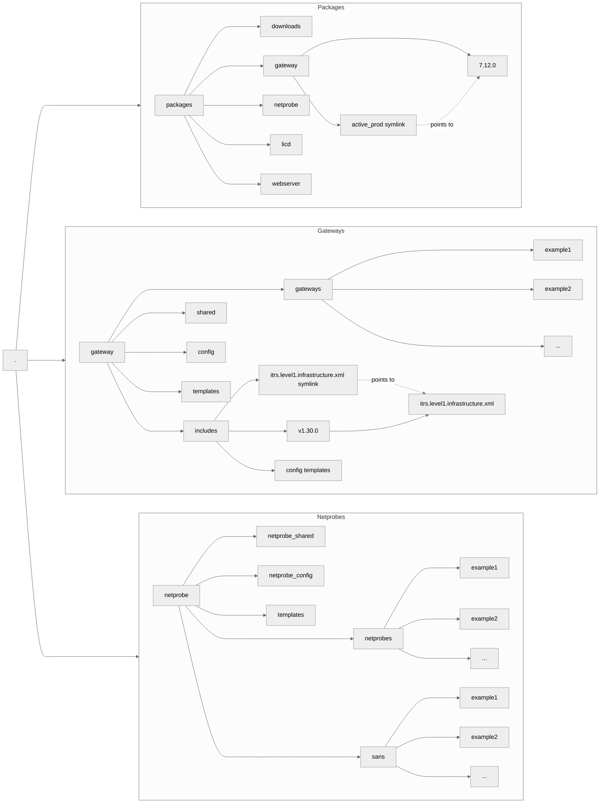

# The `geneos` Command

The `geneos` command is Cordial's command-line tool for managing ITRS Geneos. It brings common lifecycle, configuration, package, security, and diagnostic tasks into one interface for local and remote hosts. This helps you apply changes consistently, reduce repeated manual work, and maintain fewer one-off scripts.

## Documentation

- [Getting started](GETTING_STARTED.md) for installation and first steps

- [User guide](USER_GUIDE.md) for common management workflows

- [Quick reference](QUICKREFGUIDE.md) for command syntax

- [Usage examples](USAGE.md) for sample operations

- [Documentation index](DOCUMENTATION.md) to find other guides

## Why use the `geneos` command?

- **One operational interface:** Manage Geneos components and packages through consistent commands across hosts.

- **Repeatable deployments:** Use profiles and ready-made Gateway includes as starting points for common monitoring setups.

- **Security by default:** New deployments use TLS and can use certificates issued by a private certificate authority managed with the command.

- **Built-in diagnostics:** Review running processes, logs, configuration, startup commands, and Gateway Dataviews without assembling a separate toolset.

- **Operational visibility:** Audit records capture selected command invocations and instance actions; recognized sensitive values are redacted.

## Current release highlights

The current development release adds capabilities that support these workflows:

- **Profiles and includes (preview):** Reuse deployment settings and embedded best-practice Gateway configuration for common scenarios.

- **Gateway snapshots (preview):** Capture Dataviews as JSON or Toolkit-compatible output, including multi-Dataview output for supported Netprobes.

- **Audit logging:** Review selected command and instance actions in global and per-instance logs.

- **Active Dashboard tools:** Use `geneos adb info` and `geneos adb clean` to inspect and clean Active Dashboard files.

## Quick start

### Install

The release page provides pre-built binaries. On common Linux distributions such as Ubuntu, Debian, and RHEL, use a per-user directory such as `~/.local/bin` or `~/bin`, then add it to your `PATH`. For Linux x86-64:

```bash
mkdir -p "$HOME/.local/bin"
curl --fail --location --output "$HOME/.local/bin/geneos" \
  https://github.com/ITRS-Group/cordial/releases/latest/download/geneos
chmod 0755 "$HOME/.local/bin/geneos"
export PATH="$HOME/.local/bin:$PATH"
geneos version
```

Add the `PATH` update to your shell's startup file for future sessions. Use `~/bin` instead if that is your preferred user directory.

### First steps

For an existing installation, configure the command to use its root directory, then check what is configured and running:

```bash
geneos config set geneos=/opt/itrs
geneos list
geneos ps
```

For a new demonstration environment, use the supplied `demo` profile. Downloads require an ITRS account; you can provide the account name with `-u` or sign in first with `geneos login`:

```bash
geneos init demo -u user@example.com
geneos list
geneos ps
```

## Adopt an existing installation

If you already manage Geneos with older tools such as `gatewayctl` or `netprobectl`, you can use the `geneos` command with the existing installation. Set the Geneos root to the directory containing `packages`, `gateway`, and related component directories:

```bash
geneos config set geneos=/opt/itrs
```

You can also set `ITRS_HOME` to this directory. Start by checking the installation with read-only commands:

```bash
geneos list
geneos ps
```

Before changing an adopted installation, review any legacy `.rc` configuration. In particular, global `.rc` settings are not automatically imported; check that required environment variables and parameters are present.

### Legacy command names

For scripts that call component-specific `*ctl` commands, the `geneos` command can create compatibility links:

```bash
geneos migrate --executables
```

This creates links for supported legacy command names in the Geneos `bin` directory. Compatibility is not complete for every legacy operation, so test existing scripts before relying on the links.

```bash
geneos revert --executables
```

For example, `gatewayctl all start` maps to `geneos start gateway all`.

### Command Structure

Most commands follow this pattern:

```text
geneos COMMAND [flags] [TYPE] [NAME...]
```

- `COMMAND` is the command name and may include a subcommand.

- `flags` are optional settings; use `geneos help COMMAND` to check available options.

- `TYPE` is an optional component type, such as `gateway` or `netprobe`.

- `NAME` is an optional instance name. Where supported, add `@HOST` to target a specific host, or use `--host`/`-H` to limit the operation.

Options can differ between commands. Check the command help before using a flag in an operational script.

## Concepts & Terminology

The terms below describe how the `geneos` command organises and manages an installation.

Some names are retained for compatibility with earlier Geneos management tools.

### Components

A _component_ is a separately installable part of Geneos, such as a Gateway, Netprobe, or Licence Daemon.

The [component reference](docs/geneos.md#component-types) lists the supported component types.

A component type can also identify a variant of another type. For example, a Self-Announcing Netprobe can use a standard Netprobe or Fix Analyser 2 package.

In command syntax, a component type is shown as `TYPE`.

Use the [`geneos package`](cmd/pkgcmd/README.md) commands to manage component releases.

### Instances

An _instance_ is a configured, runnable copy of a component. It has a working directory, a configuration file, and related files. The `geneos` command manages each instance separately from other instances of the same type.

In command syntax, an instance is shown as `NAME`.

An instance name must be unique, without regard to case, for its component type and host. It must not be a reserved command or component name.

Use `NAME@HOST` to identify an instance on a particular host.

### Hosts

A _host_ is a system where components are installed and managed. `localhost` is always available. Many commands default to the `all` host scope; use `--host`/`-H` to select a configured host where supported.

Use the [`geneos host`](cmd/hostcmd/README.md) commands to manage remote hosts.

## Instance Protection

Protect important instances from operations that could stop, delete, or otherwise affect their availability:

```bash
geneos protect gateway CRITICAL_GW
```

To remove protection, use the same command with `--unprotect`:

```bash
geneos protect gateway CRITICAL_GW --unprotect
```

Protection blocks supported operations that affect instance state or availability. Some commands provide `--force` to override it; review the impact before doing so.

## Security

### Secure communications

New deployments use TLS by default unless you choose `--insecure` during initial setup. By default, the `geneos` command creates a private root and signing certificate authority and issues certificates for instances. For additional hosts, use the established trust chain or provide your own signing or certificate bundle. The `geneos tls` commands help you create, inspect, import, export, renew, and distribute certificates.

### Credentials and audit

Use `geneos login` to store credentials for supported operations, such as package downloads. `geneos aes` can encode sensitive configuration values. Selected command invocations and instance actions are recorded in global and per-instance audit logs. Recognized sensitive values are redacted from logged command details; protect the logs and configuration files as operationally sensitive data.

> [!WARNING]
> Some commands block root execution by default. If a task genuinely requires elevated privileges, pass the global `--allow-root` flag, for example `sudo geneos --allow-root COMMAND`. This overrides the root guard for that invocation and may create root-owned files. Run the command as the Geneos service account whenever possible.

## Diagnostics

Use the built-in commands to investigate common operational issues without assembling a separate set of tools:

- `geneos ps` lists running instances. Use `geneos ps --files` to inspect open files or `geneos ps --network` to inspect TCP sockets; these views are mutually exclusive.

- `geneos logs --follow --lines 50 gateway MyGateway` follows recent logs for a Gateway. Logs can also be filtered and read from remote hosts.

- `geneos command gateway MyGateway` shows the command and environment used to start an instance.

- `geneos show --validate gateway MyGateway` asks the Gateway to validate its setup.

- `geneos snapshot gateway MyGateway XPATH` fetches matching Dataview data. Snapshot output can be JSON or Toolkit format.

Check `geneos help COMMAND` for options and prerequisites. For example, Gateway snapshots require the Gateway REST Command API to be enabled.

## Instance Settings

Each instance has a configuration file in its instance directory. New instances use a component-specific `.json` file. Adopted installations may still contain legacy `.rc` files.

### JSON Configuration Files

JSON configuration files contain common parameters and component-specific settings. Some parameter names have different meanings for different component types.

Use the `geneos set` and `geneos unset` commands to make changes so the command can validate and save the configuration consistently.

### Special parameters

You can set or unset custom environment variables for instances with `geneos set` and `geneos unset`.

Gateways, Self-Announcing Netprobes, and Floating Netprobes also support component-specific settings. See the `set`, `unset`, `add`, and `init` command help for details.

To set an environment variable use this syntax:

```bash
geneos set netprobe example1 -e PATH_TO_SOMETHING=/file/path
```

An existing value is overwritten.

To remove an entry, use `unset`:

```bash
geneos unset netprobe example1 -e PATH_TO_SOMETHING
```

You can specify multiple entries by using the flag more than once:

```bash
geneos set netprobe example1 -e JAVA_HOME=/path -e ORACLE_HOME=/path2
```

Quote values that contain spaces so the shell passes them as one argument:

```bash
geneos set netprobe example1 -e MYVAR="a string with spaces"
geneos set netprobe example1 -e "MYVAR=a string with spaces"
```

Review an instance's configuration with `show`:

```bash
geneos show netprobe example1
```

To see the command and environment that `start` will use:

```bash
geneos command netprobe example1
```

Use the relevant command help for other component-specific settings.

### File and URLs

Some settings that accept files also accept URLs, for example certificate bundles and licence files. Check the component documentation for the settings that support this.

Gateway include files used in templates are an exception: a URL is retained as a URL in the generated configuration.

### Legacy Configuration Files

Legacy `.rc` files use a simple key/value format, for example:

```bash
GatePort=1234
GateUser=geneos
```

The prefix identifies the component and the suffix identifies the parameter. Lines without the prefix are treated as environment variables. Values such as `${HOME}` are expanded at run time. Use `geneos show --raw` to inspect unexpanded configuration values.

> [!NOTE]
> Legacy settings such as `xxxxUser=whoever` (for example, `GateUser=geneos`) do not select an operating-system user. The `geneos` command does not switch users per instance: local instances run as the invoking account, and remote instances run as the configured SSH account.

The `geneos` command reads legacy `.rc` files but does not edit them in place. When a configuration is migrated, it is saved as JSON and the original file is retained with an `.rc.orig` suffix.

Use `geneos migrate` to convert a legacy configuration. `geneos revert` can restore the original file, but changes made to the JSON configuration after migration are not carried back.

Use `geneos migrate` before changing legacy settings. Components managed by the `geneos` command run in the background; legacy execution-mode settings such as `GateMode` are not supported.

#### Instance Configuration File

Instance directories are stored under the Geneos root, often `/opt/itrs` or `/opt/geneos`. Directory names vary by component type. In the example below, `TYPE` is the component type and `INSTANCE` is its name:

```text
GENEOS_BASE_DIRECTORY/TYPE/TYPEs/INSTANCE/TYPE.json
```

## Example directory layout



This diagram shows a simplified layout. Directory names vary by component type and installation.
