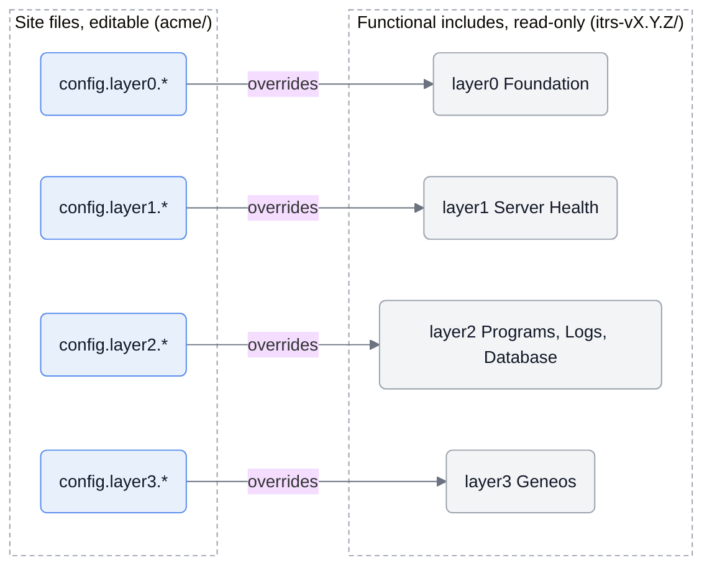

# `geneos includes`

# Geneos Gateway Includes

Geneos Gateway includes package reusable monitoring definitions and editable configuration templates. They keep common functionality consistent across Gateways while allowing each Gateway to provide its own entities, variables, and overrides.

The `itrs.*.xml` files are functional includes. Treat them as read-only and upgrade them by installing a newer release. The `config.*.xml` files are local configuration templates; customize these or copy their settings into the Gateway setup. Installing files does not automatically add them to a Gateway's setup or enable monitoring.

## Monitoring Layers

The Geneos Best Practice layers describe the scope and depth of monitoring, from the monitoring platform itself through infrastructure and applications to services and business activity. Layer numbers are not file versions or include priorities.

| Layer | Meaning |
| --- | --- |
| **0 - Foundation** | Shared Gateway configuration and monitoring-platform services, such as authentication, severity definitions and configuration validation. |
| **1 - Infrastructure** | Server health: CPU, memory, disk, hardware and network monitoring. The supplied include calls this `Server Health`. |
| **2 - Application Baseline** | Common monitoring building blocks for applications, including processes, logs, Windows services and database health. |
| **3 - Applications** | Application-specific monitoring that builds on the baseline where appropriate, such as Geneos instance, component and Gateway-load monitoring. |
| **4 - End-to-End** | Monitoring complete service paths across application and infrastructure boundaries. |
| **5 - Business Activity** | Monitoring business transactions, activity and outcomes rather than only the underlying technology. |

The supplied functional includes currently cover Layers 0 to 3.

The standard corpus is versioned independently of Cordial. Its initial version
is `v2.0.0`, to distinguish it from earlier unpackaged releases, and recorded in the source tree's `pkg/includes/VERSION`, and follows semantic versioning.
Installations use this corpus version independently of the Cordial executable
version. Holiday snapshots have their own source-fetch-date versions.

## Files

Release archives are named `geneos-includes-v<version>.tar.gz` and have a single top-level directory named `geneos-includes-v<version>`. It contains functional includes under `itrs-v<version>/`, an unversioned `config/` directory of templates, `scripts/install-includes.sh`, and a `docs/` directory with this README and the Markdown include documentation plus generated PDF versions. The script and documentation are not copied into the Gateway's live include directory.

The prefix is the include **source**, independently of the deployment's site. User-created archives can use another source, for example `acme-ops-v1.2.3/` containing `acme-ops.*.xml`. Source names begin with a letter or digit and use letters, digits, dots, underscores or hyphens; `config` is reserved for templates. The suffix is a `v`-prefixed semantic version; prerelease and build metadata are supported, and the archive wrapper's version must match this suffix. Legacy unprefixed semantic-version directories remain supported as the `itrs` source. Listings show the full directory name in version columns.

| File | Purpose |
| --- | --- |
| `itrs.layer0.foundation.xml` | Gateway information, license/severity views, and configuration validation tools. |
| `itrs.layer1.server-health.xml` | Server health monitoring for CPU, disk, hardware, and network interfaces. |
| `itrs.layer2.programs-and-logs.xml` | Shared `Logs`, `Processes`, and Windows Services samplers for the Application Baseline. |
| `itrs.layer2.database-health.xml` | SQL Toolkit Baseline and Extended types, samplers and database connections for MySQL, MariaDB, Oracle, PostgreSQL, SQL Server, SAP ASE and IBM Db2. No rules. |
| `itrs.layer3.geneos.xml` | Geneos instance, component, and Gateway-load monitoring types, samplers, rules, and commands. |
| `config.layer0.authentication.xml` | Authentication roles and policies plus example local users/groups; review and replace example identities before use. |
| `config.layer0.foundation.xml` | Empty Gateway setup template for local foundation settings. |
| `config.layer1.server-health.xml` | `Layer 1 - Server Health` managed-entity group with attributes and the type, plus an empty `Layer 1 - Server Health Local` override environment. |
| `config.layer2.programs-and-logs.xml` | `Layer 2 - Application Baseline` managed-entity group with attributes and the type, plus an empty `Layer 2 - Application Baseline Local` override environment. |
| `config.layer2.database-health.xml` | Empty Gateway setup template for local database connection environments and overrides. |
| `config.layer3.geneos.xml` | Example managed-entity hierarchy, per-entity component variables, and sampling override environments for Layer 3 Geneos. |

Each functional include has a matching configuration template. The template is where site settings go, and its `Local` environment overrides the defaults in the read-only include:



Holiday calendars are a separate optional corpus under the `holidays` source,
distributed as `geneos-holiday-includes-vYYYY.MM.DD.tar.gz`.

Its documentation is in the archive's `docs/README.md` and regional pages
(source tree: `pkg/holidays/`). Installing it makes calendars available but
does not add them to Gateway setups or enable holiday scheduling.

Choose a site name representing the company, customer, or client using the Geneos deployment, rather than a region or environment. For example, an installation using the site `acme`, ITRS includes and an additional `acme` source has files organized like this:

```text
gateway/
├── includes/
│   ├── itrs.layer0.foundation.xml -> itrs-v2.0.0/itrs.layer0.foundation.xml
│   ├── acme.trading.xml -> acme-v1.2.3/acme.trading.xml
│   ├── ...
│   ├── itrs-v2.0.0/
│   │   ├── itrs.layer0.foundation.xml
│   │   └── ...
│   └── acme-v1.2.3/
│       ├── acme.trading.xml
│       └── ...
└── acme/
    ├── acme-config.layer0.authentication.xml
    ├── acme-config.trading.xml
    └── ...
```

The links let Gateway setups use a stable path while the target version changes. Configuration templates are regular files named `<site>-config.*.xml`, copied only when absent and not overwritten by later installs. Keeping `-config` in the filename distinguishes a site override from a functional include even when source and site have the same name. The archive itself always uses the `config` names listed above. Templates from different sources share the site directory, so choose distinct template basenames unless they are deliberately shared.

> [!NOTE]
> Please note the following when choosing and using a site name:
>
> - The site name determines the Gateway configuration include directory and filename prefix.
>
> - With `geneos`, spaces become underscores in paths; `scripts/install-includes.sh` rejects them. The resulting name must be a safe single directory path component and cannot conflict with Gateway directories such as `config` or `includes`.
>
> - If no site name is set, the directory and prefix are `local`.
>
> - Only one site name is supported per installation.
>
> - Use the same site name on all Geneos servers for consistent paths.
>
> - Changing the site name later does not rewrite existing Gateway setups. Review their paths and populate the new site directory before switching them.

On installation, files from the older `gateway/includes/config` directory and the previous `<site>.*.xml` site naming are copied to `<site>-config.*.xml` before new templates are installed. Existing destination files are not replaced, and originals remain for previous Gateway setups. The script copies all legacy config files and does not inspect Gateway setup references.

## Installation

> [!IMPORTANT]
> Include and site filenames have changed from `levelN` to `layerN`, and Gateway types, groups, environments and XPath targets now use `Layer N` names. The former `itrs.level1.infrastructure.xml` and `itrs.level2.application-core.xml` are now `itrs.layer1.server-health.xml` and `itrs.layer2.programs-and-logs.xml`. Back up your configuration, copy or merge site overrides into the new site files without overwriting existing settings, and update every Gateway setup reference. Existing configurations are not renamed automatically.

### Install

Use `scripts/install-includes.sh` from the extracted archive. Its required argument is the absolute destination include directory; its optional second argument is the site name and defaults to `local`. The script uses the current directory as its source; set `INCLUDES_SOURCE` to use another extracted source directory.

```shell
tar -xzf /path/to/geneos-includes-v2.0.0.tar.gz
cd geneos-includes-v2.0.0
./scripts/install-includes.sh /path/to/deployment/gateway/includes
```

To install configuration templates for a specific site, supply its name:

```shell
./scripts/install-includes.sh /path/to/deployment/gateway/includes acme
```

The script installs into a fresh version directory, keeps existing configuration files, and creates only missing top-level links. For archives with a `config/` directory, it writes `<site>-config.*.xml` into `<site>/` beside the destination directory. Use the same destination and site for later releases; changing either requires checking and updating Gateway setup references.

Choose a destination whose files can be referenced with a relative path from the Gateway working directory. Keeping that relationship inside the Gateway deployment allows the deployment to be relocated without rewriting setup-file paths. The script assumes a trusted, already-extracted archive, rejects an existing version, and does not overwrite configuration files or existing links.

The holiday archive bundles the same source-aware shell installer. Archives
without a `config/` directory, including holidays, do not create or migrate site
configuration. Each archive installs only its own source and preserves existing
top-level files and links.

## How-To

Installing include files only makes them available on disk. Use the Gateway Setup Editor (GSE) to add the include files to each Gateway setup and attach the provided types to the appropriate managed entities. Reference the stable top-level link for functional includes, for example `../../includes/itrs.layer1.server-health.xml`, and the site template, for example `../../acme/acme-config.layer1.server-health.xml`; adjust relative paths for the Gateway setup location and your site name. Prefer such relative paths over absolute paths so the Gateway deployment remains relocatable. Do not reference the version directory directly. Include priorities must be unique. For a functional include and its local config, give the config include a numerically lower priority so its settings take precedence. Review each template before enabling it.

### Manage with shell tools

List installed include files and broken top-level links:

```shell
INCLUDES_DIR=/path/to/geneos/gateway/includes
find "$INCLUDES_DIR" -maxdepth 2 \( -type f -o -type l \) -name '*.xml' -print | sort
find "$INCLUDES_DIR" -maxdepth 1 -type l -xtype l -print
```

To switch links to an already installed version, first inspect the Gateway setup references and back up any regular files at the link paths. Then repoint links for files present in the selected version:

```shell
VERSION=itrs-v2.0.0
INCLUDES_DIR=/path/to/geneos/gateway/includes

for source in "$INCLUDES_DIR/$VERSION"/itrs.*.xml; do
    [ -f "$source" ] || continue
    name=${source##*/}
    link="$INCLUDES_DIR/$name"
    if [ -e "$link" ] && [ ! -L "$link" ]; then
        cp -p "$link" "$link.$(date +%Y%m%d%H%M%S).bak"
    fi
    ln -sfn "$VERSION/$name" "$link"
done
```

This updates matching links only. It does not detect obsolete references or remove old links. Before removing an old version, inspect its links and every Gateway setup that may refer to them.

```shell
OLD_VERSION=itrs-v0.9.0
INCLUDES_DIR=/path/to/geneos/gateway/includes

# Preview top-level links with a direct relative target under this version.
# Inspect absolute links and Gateway setup references separately.
find "$INCLUDES_DIR" -maxdepth 1 -type l -lname "$OLD_VERSION/*" -print

# Only after confirming no Gateway setup uses this version:
find "$INCLUDES_DIR" -maxdepth 1 -type l -lname "$OLD_VERSION/*" -exec rm -f -- {} +
rm -rf -- "$INCLUDES_DIR/$OLD_VERSION"
```

For a broken link, inspect its target with `readlink` and confirm there is exactly one intended replacement with the same basename before recreating it with `ln -s`. Check all Gateway setup references before changing or removing links.


## Commands

| Command / Aliases | Description |
|-------|-------|
| [`geneos includes delete / remove`](geneos_includes_delete.md)	 | Delete unused include versions and links |
| [`geneos includes fix`](geneos_includes_fix.md)	 | Repair broken gateway include references |
| [`geneos includes install / extract`](geneos_includes_install.md)	 | Install embedded includes or includes from an archive |
| [`geneos includes list / ls`](geneos_includes_list.md)	 | List all available include files |
| [`geneos includes update`](geneos_includes_update.md)	 | Update includes |

### Options

```text
      --allow-root[=true|false]   allow running as root (not recommended)
  -G, --config string             config file (defaults are ~/.config/geneos/geneos.json, /etc/geneos/geneos.json)
  -H, --host HOSTNAME             Limit actions to HOSTNAME (not for commands given instance@host parameters) (default "all")
      --profiles string           profiles configuration (defaults are ~/.config/geneos/profiles.yaml, /etc/geneos/profiles.yaml)
```

## SEE ALSO

* [geneos](geneos.md)	 - Take control of your Geneos environments
